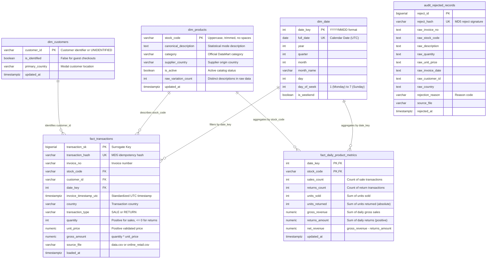

# Technical Decisions & Architectural Design
## DataMart S.A.S. - Analytical Data Platform

---

## 1. Executive Summary

This document provides a comprehensive technical justification for the design and architectural decisions implemented in the **DataMart S.A.S. End-to-End ETL & Data Warehouse Platform**. The platform was developed to resolve operational reporting bottlenecks, consolidate heterogeneous sales channels, and establish an automated, idempotent analytics repository in PostgreSQL orchestrated by Apache Airflow.

---

## 2. Data Warehouse Dimensional Modeling (Star Schema)

### 2.1 Schema Paradigm & Rationale
An enterprise **Star Schema (Kimball Methodology)** was selected over a normalized 3NF schema for the analytical repository (`datamart_dw`). The primary motivations include:
* **Analytical Query Performance:** Minimizes multi-table joins when computing aggregations across high-cardinality transaction datasets (>1 million rows).
* **Clear Business Semantics:** Decouples operational entities (Products, Customers, Calendar) from transactional events (Sales and Returns).
* **Separation of Granular vs. Aggregated Facts:** Provides both invoice-line transactional fidelity (`fact_transactions`) and pre-aggregated daily product profitability (`fact_daily_product_metrics`) to satisfy executive KPIs without redundant full-table scans.

### 2.2 Entity Relationship Diagram (ERD)

---

## 3. Resolution of Ambiguous Cases (Section 5)

### 3.1 Ambiguity 1: Transactions without Customer ID
* **The Dilemma:** Approximately 25% of transactional records lack an authenticated `CustomerID` (null or empty string).
* **Business Decision:** **Preserve all records** by attributing them to a synthetic surrogate customer record: `customer_id = 'UNIDENTIFIED'` with `is_identified = FALSE` in `dim_customers`.
* **Justification & Business Impact:**
  * Dropping these records would have discarded **$3,510,553.28 USD** in legitimate company revenue (16.45% of total gross sales).
  * Inventory levels and product-level demand forecasts would have been severely corrupted.
  * In behavioral analytics (retention and cohort analysis), queries can simply filter `WHERE is_identified = TRUE`, while financial reporting retains complete reconciliation.

### 3.2 Ambiguity 2: Inconsistent Product Descriptions
* **The Dilemma:** The same `StockCode` appears with various textual iterations across years and sources (e.g., `"VINTAGE LEAF MAGNETIC NOTEPAD"`, lowercase iterations, and minor spacing differences).
* **Business Decision:** 
  1. Standardize all descriptions during transformation (uppercase, stripped whitespace, collapsed multiple spaces).
  2. Select the **statistical mode** (the most frequently occurring description for each product code) as the **canonical description** stored in `dim_products`.
  3. Track `raw_variation_count` in `dim_products` to explicitly flag and audit catalog inconsistencies for the DataMart product team.
* **Justification:** Eliminates fragmented reporting in BI dashboards while maintaining an exact audit trail of data variations.

### 3.3 Ambiguity 3: Dataset Overlap and Source Deduplication
* **The Dilemma:** `data.csv` and `online_retail.csv` share common date periods and duplicate rows.
* **Business Decision:**
  * Define a composite natural key for transaction uniqueness: `[InvoiceNo, StockCode, InvoiceDate, Quantity, UnitPrice, CustomerID]`.
  * Compute a sequential occurrence index (`occurrence_idx`) grouped by the natural key to account for valid repeated line items within the same invoice.
  * When deduplicating across sources, prioritize `data.csv` (the official daily operational dump) over `online_retail.csv` using `drop_duplicates(keep='first')`.
* **Justification:** Eliminates cross-source duplication while respecting legitimate multiple identical line items within a single invoice.

---

## 4. Implementation of Business Rules (Section 5)

| Business Rule | Implementation Strategy | Verification / Storage |
| :--- | :--- | :--- |
| **Returns & Adjustments** | Records with `Quantity <= 0` are segregated with `transaction_type = 'RETURN'`, tracking refund values and units returned. | Stored in `fact_transactions` and deducted in `fact_daily_product_metrics`. |
| **Invalid Unit Prices** | Records with `UnitPrice <= 0` or null are marked as invalid sales. | Diverted to `audit_rejected_records` with reason `'UNIT_PRICE_ZERO_OR_NEGATIVE'`. (5,034 records captured). |
| **UTC Date Standardization** | All timestamp strings are parsed using robust datetime parsing and converted explicitly to timezone-aware UTC (`InvoiceDate_utc`). | Stored as `TIMESTAMP WITH TIME ZONE` in PostgreSQL. |
| **Product Code Normalization** | Raw stock codes are converted to uppercase, trimmed, and internal whitespace stripped (`.str.strip().str.upper().str.replace(" ", "")`). | Enforced across dimensions and fact tables. |
| **Gross & Net Revenue Calculation** | `gross_revenue = SUM(quantity * unit_price)` for sales. `net_revenue = gross_revenue - returns_amount` computed per product per day. | Materialized daily in `fact_daily_product_metrics` and verified via SQL. |

---

## 5. DAG Idempotency & Bulk Loading Strategy

### 5.1 Mathematical Idempotency
To guarantee that executing the DAG multiple times on the same day with the same source files produces **identical state without duplicate rows**, we implement:
1. **Deterministic Hashing:** An MD5 hash signature (`transaction_hash`) is generated for every validated row using the natural composite key.
2. **Reject Hashing:** An MD5 signature (`reject_hash`) is generated for every rejected row.
3. **Unique Database Constraints:** PostgreSQL enforces `UNIQUE(transaction_hash)` on `fact_transactions` and `UNIQUE(reject_hash)` on `audit_rejected_records`.

### 5.2 High-Performance Loading (`COPY` + Upsert)
Standard `df.to_sql()` or iterative `INSERT` statements are unsuitable for 1+ million rows (taking 20+ minutes). We implemented an enterprise ingestion pattern:
1. Create a session temporary table (`tmp_fact_transactions`).
2. Stream DataFrame rows in memory via `StringIO` using PostgreSQL's binary **`COPY FROM STDIN`** protocol (exceeding 25,000 rows/sec).
3. Execute an atomic set-based `INSERT INTO ... SELECT ... ON CONFLICT (transaction_hash) DO NOTHING`.
4. Wrap all dimension, fact, and audit table loads within a single atomic database transaction (`raw_conn.commit()` / `raw_conn.rollback()`).

*Result:* Complete loading of **1,078,784 fact rows** and **278,011 daily aggregates** in **under 50 seconds**.
